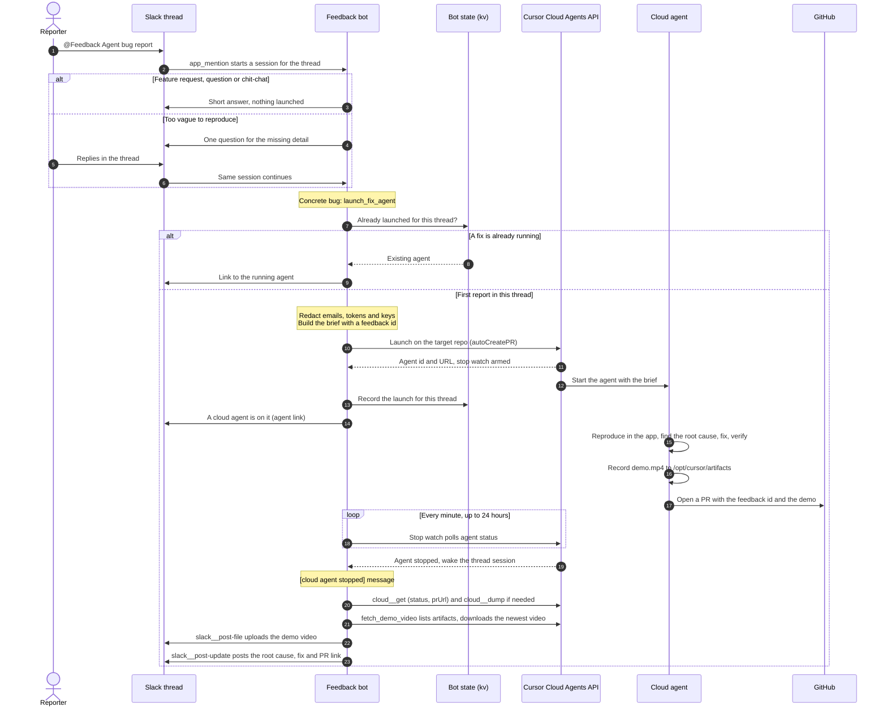

# feedback-agent

A Slack bot that turns bug reports into fixes. Someone mentions the bot with a bug, the bot launches a [Cursor cloud agent](https://cursor.com/docs/cloud-agent) on the target repo, and that agent reproduces the bug, writes the fix, opens a pull request and records a demo video. When it finishes, the bot replies in the same Slack thread with the PR and the video.

It is built on the [Agent SDK](https://www.npmjs.com/package/@grok/agent-sdk) (`@grok/agent-sdk@0.6.0`).

## The Slack flow



## How it works

| Piece | What it does |
| --- | --- |
| `bot/channels/slack.ts` | Native Slack channel (Socket Mode). Agentic replies: the bot decides when to post progress and the result. |
| `bot/extensions/slack.ts` | Native `slack-communication` tools: `post-update`, `post-file`, `post-card`, `react`. |
| `bot/extensions/cloud/` | Native `cursor-cloud-agents` extension, limited to the one target repo. Its generic `launch` tool and handoff skill are disabled, so every launch goes through `launch_fix_agent`. The extension's stop watch wakes the Slack thread when the cloud agent stops. |
| `bot/tools/launch_fix_agent.ts` | Builds the brief (redacted report plus hard rules), launches one cloud agent per thread, and records it in `ctx.host.kv`. |
| `bot/tools/fetch_demo_video.ts` | Downloads the newest video the agent saved under `/opt/cursor/artifacts` (Cursor artifacts API) into the session workspace, so the bot can post it with `slack__post-file`. |
| `bot/instructions.md` | How the bot triages a report, what it posts, and what it does when woken. |
| `evals/triage.eval.ts` | Real model turns: a clear bug launches, a feature request and a vague report do not, and an injection attempt stays data. |
| `demo-app/` | A small invoicing app with one real bug (an invoice rename reverts on blur). It is the default target. |

Carried over from the old widget library:

- The report is untrusted input. The brief tells the cloud agent never to follow instructions in it.
- Emails, bearer tokens, JWTs, Slack tokens and key-shaped strings are redacted before anything leaves Slack.
- One run per report: a second launch in the same thread returns the running agent.
- The fix stays narrow. The agent never merges, deploys or pushes to the default branch, and the PR carries a feedback id that traces back to the thread.

## Set up

You need Node 22.13 or newer (not Bun), a Cursor account with cloud agents enabled, and the target repo connected to Cursor through the GitHub app (Cursor dashboard, Integrations).

```bash
git clone https://github.com/ericzakariasson/feedback-agent
cd feedback-agent
npm install
npx agent-sdk login        # opens a cursor.com sign-in link; stores a revocable API key
```

### Point it at your repo

Edit `DEFAULT_REPO_URL` and `DEFAULT_REPO_REF` in `bot/lib/config.ts`, or set `FEEDBACK_REPO_URL` and `FEEDBACK_REPO_REF`. The default is this repo, so the bot fixes `demo-app/`. Add an `AGENTS.md` to your repo that says how to run the app and where to save demo videos (`/opt/cursor/artifacts/*.mp4`); see this repo's [`AGENTS.md`](AGENTS.md).

### Create the Slack app

The quickest path is a Cursor-managed Socket Mode app:

```bash
npx agent-sdk slack create --dir . --prefix FEEDBACK_AGENT --name "Feedback Agent"
```

Finish the wizard in the browser (pick the workspace, approve the scopes). The CLI writes `FEEDBACK_AGENT_SLACK_BOT_TOKEN` and `FEEDBACK_AGENT_SLACK_APP_TOKEN` to `.env.local` without printing them and runs `slack doctor`. If your workspace needs admin approval, keep the command running and send the **Request approval** link it prints.

If you would rather own the Slack app, run `npx agent-sdk slack init --manual --dir . --prefix FEEDBACK_AGENT --name "Feedback Agent"`, install the app from the generated manifest, and put the bot token (`xoxb-…`) and an app-level token with `connections:write` (`xapp-…`) in `.env.local` under the names in [`.env.example`](.env.example).

The default bot scopes cover everything the bot uses: `app_mentions:read`, `chat:write`, `channels:history`, `groups:history`, `im:history`, `reactions:write` and `files:write` (for the demo video).

Check it:

```bash
npx agent-sdk slack doctor --prefix FEEDBACK_AGENT
```

### Secrets

| Name | Local (`.env.local`) | Hosted |
| --- | --- | --- |
| `FEEDBACK_AGENT_SLACK_BOT_TOKEN` | Written by `slack create` | `slack create --env prod` stores it; `deploy` injects it |
| `FEEDBACK_AGENT_SLACK_APP_TOKEN` | Written by `slack create` | Same as above |
| Cursor credential | `agent-sdk login`, or `CURSOR_API_KEY` | The deployment's own credential; nothing to set |
| `FEEDBACK_REPO_URL`, `FEEDBACK_REPO_REF` | Optional | Optional: `npx agent-sdk secret set <slug> FEEDBACK_REPO_URL` (prompts for the value) |

Never commit `.env.local`. It is gitignored.

## Run locally

```bash
npx agent-sdk dev --dir .
```

Invite the bot to a channel (`/invite @Feedback Agent`) and mention it:

> @Feedback Agent renaming an invoice reverts when I click away. On /invoices I click "Website refresh", type a new name, click elsewhere, and the old name comes back.

The bot posts that a cloud agent is on it, with a link. When the agent stops, usually after several minutes, the bot posts the demo video and the PR in the thread. Reply in the thread to add detail; the bot passes it on to the running agent.

The local playground (the URL `dev` prints) can drive turns without Slack, too.

## Check

```bash
npm run check        # agent-sdk validate, tsc, and the eval list
npm run eval         # runs the evals as real model turns (needs a Cursor credential)
```

In eval sessions `launch_fix_agent` returns the brief it would send instead of launching, so evals cost no cloud-agent runs.

Call a tool directly, with no model turn:

```bash
npx agent-sdk tool call launch_fix_agent --dir . \
  --input '{"title":"Invoice rename reverts on blur","report":"Rename on /invoices snaps back when I click away"}'
```

That launches a real cloud agent when a Cursor credential is present.

## Deploy

Nothing here deploys on its own. When you are ready:

```bash
npx agent-sdk validate --dir .
git push                                   # deploy builds the pushed ref
npx agent-sdk deploy --dir .               # prints the alias token once; save it
npx agent-sdk slack create --dir . --prefix FEEDBACK_AGENT --env prod
npx agent-sdk deploy --dir .               # redeploy so the prod Slack tokens are injected
```

The deploy slug defaults to the folder name, so clone into `feedback-agent`. On hosting, launches run under the deployment's Cursor credential and spend that account's cloud-agent budget, and the target repo must be connected to that account.

### Egress

`bot/agent.ts` declares the hosts the bot calls itself; check them with `npx agent-sdk info --dir .`.

| Host | Why |
| --- | --- |
| `api.cursor.com` | Launch cloud agents; list the demo video artifact |
| `*.amazonaws.com` | The presigned download URL for the demo video |
| `slack.com`, `files.slack.com` | Added by the Slack channel |
| `api2.cursor.sh` | Cloud agent status and conversation; part of the platform's bootstrap set |

If your team restricts egress, each declared host must be on the team allowlist, or `deploy` fails and names it.

## Layout

```text
bot/
  agent.ts                 model, tools allowlist, egress and secret names
  instructions.md          triage and reply behavior
  channels/slack.ts        Slack channel
  extensions/slack.ts      Slack communication tools
  extensions/cloud/        cloud agents extension (launch disabled)
  tools/                   launch_fix_agent, fetch_demo_video
  lib/                     brief, redaction, config, artifacts API, kv records
evals/                     triage evals
demo-app/                  the app the default target fixes
```

## License

MIT
